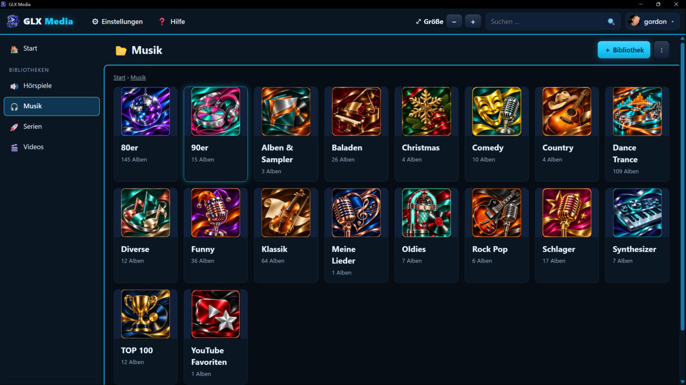
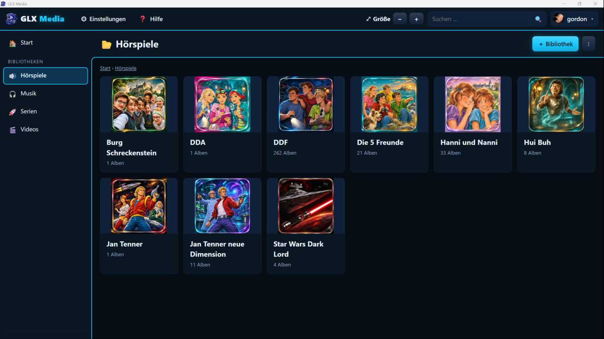

🌍 Sprachen: [🇺🇸 English](README.md) | [🇩🇪 Deutsch](README.de.md)

# 💠 GLX Media Windows

### Deine Mediathek am Windows-PC.

*Das kostenlose Windows-Programm zum GLX Media Server.* ⚡

   

---

## ⬇️ Download

👉 Neueste Version: [Releases](../../releases/latest)  
👉 Shop und Lizenzen: [glx-tools.de](https://glx-tools.de/product/glx-media-windows/)

---

## 📖 Über GLX Media Windows

### Deine Mediathek auf dem PC

GLX Media Windows zeigt deine Filme, Serien, Musik und Hörspiele vom GLX Media Server in einem eigenen Programmfenster an. Kein Browser-Tab, keine Adresse merken: Programm öffnen, und deine Bibliotheken mit Covern und Beschreibungen sind da.

### Die GLX Media Familie

Das Hauptprogramm ist der GLX Media Server. Er läuft bei dir zu Hause und verwaltet Bibliotheken, Cover, Benutzer und Weiterschauen. Mit einem GLX Media Server nutzt du kostenlos GLX Media Windows für den PC, GLX Media Android TV für den Fernseher, GLX Media Smartphone für das Handy und GLX Remote als Fernbedienung. Auf iPhone und iPad installierst du GLX Media über Safari als Web-App auf dem Home-Bildschirm. Was du auf einem Gerät änderst, siehst du sofort auf allen anderen.

### Alles bleibt synchron

Was du in GLX Media Windows änderst, zum Beispiel Bibliotheken, Cover, Benutzer oder gesehene Folgen, wird auf dem Server gespeichert. Es erscheint sofort auch im Browser, auf dem Fernseher und auf dem Handy. Am PC anfangen, am Fernseher weiterschauen.

### Einfach verbinden

Beim ersten Start sucht GLX Media Windows deinen Server selbst im Heimnetz. Findet es keinen, gibst du die Adresse ein, auch eine Adresse von außen ist möglich. Zuletzt verbundene Server stehen in einer Liste. Anmelden kannst du dich auch bequem mit dem Handy per QR-Code.

### GLX Player

Filme laufen im GLX Player wie auf dem Fernseher, mit Tonspur, Untertitel, Zufall, Wiederholen und Marker. Mit F11 schaltest du auf Vollbild. Musik und Hörspiele laufen mit Player-Leiste weiter, während du durch die Bibliothek blätterst.

### Design und Update

Es gelten die 12 GLX Designs und 10 Icon-Sets, die du in GLX Media eingestellt hast. GLX Media Windows aktualisiert sich selbst unter Einstellungen › Update. Neue Versionen kommen nur von glx-tools.de, mit Unterschrift und Prüfsumme.

### Kostenlos

GLX Media Windows ist kostenlos. Lizenz und Testzeit gibt es nur am GLX Media Server.

---

## 📸 Überblick & Screenshots

### 1️⃣ Musik-Bibliothek

### 2️⃣ Hörspiele

---

## ✨ Funktionen

- 🚀 **Mediathek im Überblick:** Filme, Serien, Musik und Fotos mit Cover und Beschreibung.
- 🧩 **Ordneransicht:** Die Mediathek des Servers nach Ordnern durchsuchen.
- ⚙️ **Abspielen am PC:** Videos und Musik laufen direkt im Programm.
- 🔒 **Weiterschauen:** Der Wiedergabestand wird mit dem Server und anderen Geräten abgeglichen.
- 📂 **Designs:** Mehrere Farbdesigns im GLX-Look.
- ⚡ **Zwei Sprachen:** Deutsch und Englisch.

---

## 🧩 Systemanforderungen

- Windows 10 oder 11 (64 Bit)
- Microsoft WebView2
- Ein laufender GLX Media Server im Netzwerk oder Internet

---

## 🧪 Testzeitraum & Lizenz

Kostenlos. Benötigt einen GLX Media Server.

---

## 🔗 Mehr zu diesem Produkt

👉 [glx-tools.de](https://glx-tools.de/product/glx-media-windows/)  
Support: **info@glx-tools.de**

---

## 📄 Lizenz

Copyright © 2026 GLX Tools – Gordon Lehmann. Alle Rechte vorbehalten.  
Dies ist proprietäre kommerzielle Software. Es wird keine Open-Source-Lizenz gewährt. Dieses Repository enthält nur Release-Downloads und Dokumentation; der Quelltext wird nicht veröffentlicht.

---

Mit ❤️ gemacht von **Dreamdancer100**

