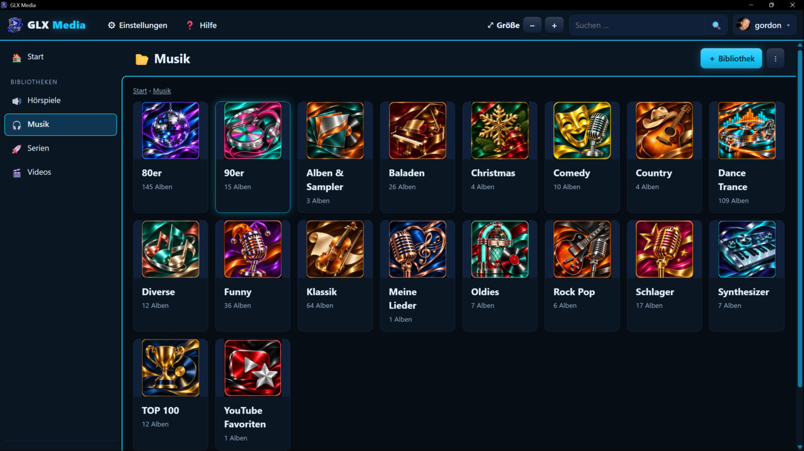
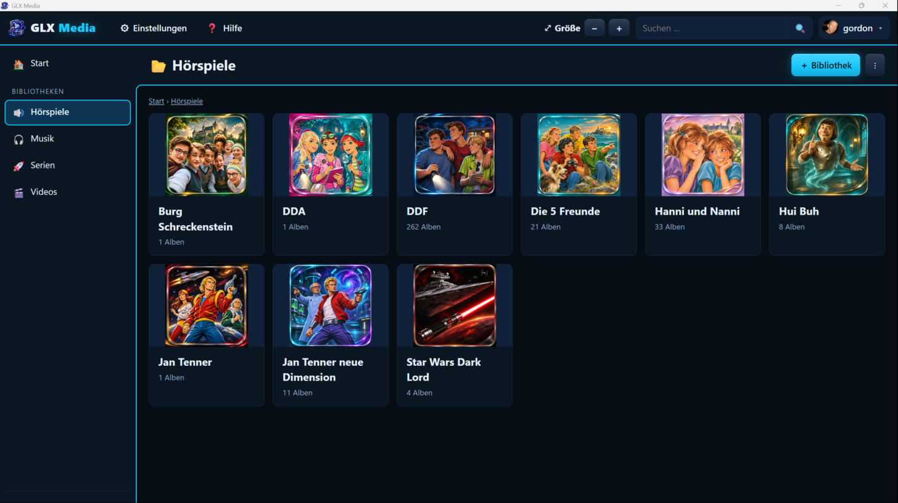

🌍 Languages: [🇺🇸 English](README.md) | [🇩🇪 Deutsch](README.de.md)

# 💠 GLX Media Windows

### Your media library on the Windows PC.

*The free Windows client for GLX Media Server.* ⚡

   

---

## ⬇️ Download

👉 Latest version: [Releases](../../releases/latest)  
👉 Shop and licences: [glx-tools.de](https://glx-tools.de/product/glx-media-windows/)

---

## 📖 About GLX Media Windows

### Your media library on the PC

GLX Media Windows shows your films, series, music and audio books from your GLX Media Server in its own program window. No browser tab, no address to remember: open the program and your libraries with covers and descriptions are there.

### The GLX Media family

The main program is GLX Media Server. It runs at your home and manages libraries, covers, users and resume playback. With a GLX Media Server you can use GLX Media Windows for the PC, GLX Media Android TV for the TV, GLX Media Smartphone for your phone and GLX Remote as a remote control, all free of charge. On iPhone and iPad you install GLX Media as a web app on the home screen via Safari. Whatever you change on one device shows up on all others right away.

### Everything stays in sync

Whatever you change in GLX Media Windows, for example libraries, covers, users or watched episodes, is saved on the server. It shows up right away in the browser, on the TV and on your phone. Start on the PC, continue on the TV.

### Easy to connect

On the first start GLX Media Windows finds your server in your home network by itself. If it finds none, you enter the address, an address from outside works too. Recently used servers are kept in a list. You can also sign in comfortably with your phone via QR code.

### GLX Player

Films play in the GLX Player just like on the TV, with audio track, subtitles, shuffle, repeat and markers. F11 switches to full screen. Music and audio books keep playing in the player bar while you browse the library.

### Design and updates

The 12 GLX designs and 10 icon sets you chose in GLX Media apply here too. GLX Media Windows updates itself under Settings › Update. New versions only come from glx-tools.de, signed and checked with a checksum.

### Free of charge

GLX Media Windows is free. Licence and trial only apply to GLX Media Server.

---

## 📸 Overview & Screenshots

### 1️⃣ Music library

### 2️⃣ Audio books

---

## ✨ Features

- 🚀 **Library at a glance:** Movies, series, music and photos with covers and descriptions.
- 🧩 **Folder view:** Browse the server library by folders.
- ⚙️ **Play on the PC:** Videos and music play directly in the program.
- 🔒 **Resume playback:** Playback position is synced with the server and other devices.
- 📂 **Designs:** Several color designs in the GLX look.
- ⚡ **Two languages:** German and English.

---

## 🧩 Requirements

- Windows 10 or 11 (64-bit)
- Microsoft WebView2
- A running GLX Media Server in your network or on the internet

---

## 🧪 Trial & License

Free of charge. Requires a GLX Media Server licence.

---

## 🔗 More about this product

👉 [glx-tools.de](https://glx-tools.de/product/glx-media-windows/)  
For support: **info@glx-tools.de**

---

## 📄 License

Copyright © 2026 GLX Tools – Gordon Lehmann. All rights reserved.  
This is proprietary commercial software. No open-source license is granted. This repository contains release downloads and documentation only; the source code is not published.

---

Made with ❤️ by **Dreamdancer100**

